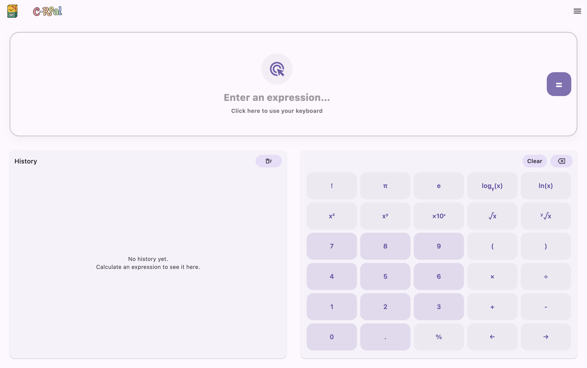
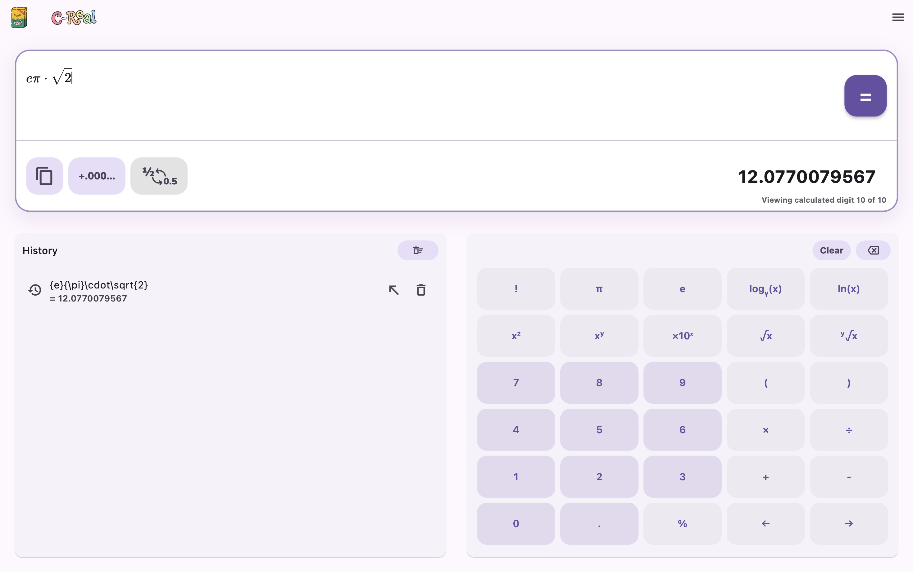

# C-Real

Jednoduchá multiplatformní kalkulačka s výsledky s neomezenou přesností, vytvořená ve Flutteru a balená pro Linux (`.deb`) a Windows.


## Funkce

- Základní aritmetika: sčítání, odčítání, násobení, dělení
- Výsledky s neomezenou přesností pomocí vlastní matematické knihovny
- Historie výpočtů
- Čisté a responzivní uživatelské rozhraní ve Flutteru
- Podpora desktopových platforem
- Moderne navržené UI

## Požadavky

Ujistěte se, že máte nainstalováno:

- [Flutter](https://docs.flutter.dev/get-started/install)
- [Dart](https://dart.dev/get-dart) (obvykle je součástí Flutteru)
- Pro balení pro Linux: build nástroje pro Debian/Ubuntu
- Pro buildy pro Windows: povolenou podporu desktopu ve Flutteru

Zkontrolujte své nastavení:

```bash
flutter doctor
```

## Jak začít

### Běžná verze
1. Stahněte instalační balíček pro vaši platformu z [releases](https://github.com/K0stkaORG/IVS-Projekt-2/releases)
2. Nainstalujte aplikaci podle pokynů pro vaši platformu.
3. Spusťte aplikaci a začněte používat.

### Debug verze
1. Stahněte repozitář a otevřete terminál v zložce kde se nachází.

2. Presunte se do kořenového adresáře projektu:
```bash
cd ./IVS-PROJEKT-2/src
```

3. Spusťte aplikaci:
```bash
make all && make run
```

## Screenshoty




Prostredi
---------

Ubuntu 64bit
Windows 64bit

Autori
------

[object Object]
- xburesd00 David Alois Bureš 
- xkostkj00 Jan Kostka
- xpollal00 Lukáš Pollák 

Licence
-------

Tento program je poskytovan pod licencí GNU General Public License v3.0. Více informací naleznete v souboru [LICENSE](LICENSE).
